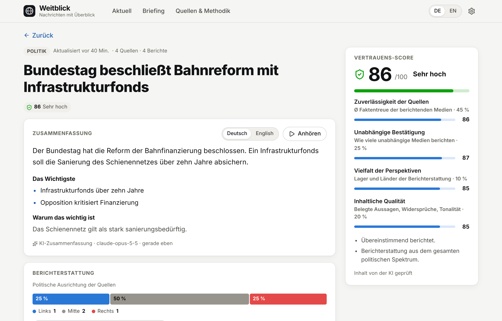
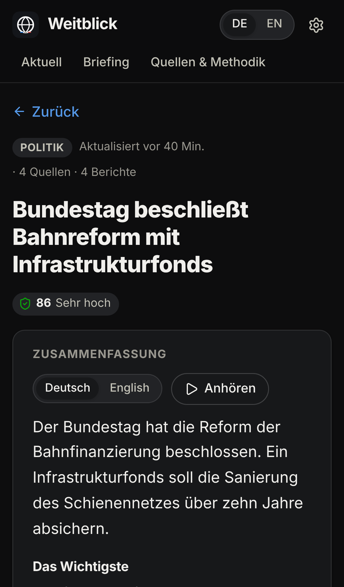

# Weitblick – Nachrichten mit Überblick

Weitblick ist eine Nachrichten-App nach dem Vorbild von Ground News. Sie sammelt laufend die neuesten
Meldungen aus über 50 Medien (Deutschland, Österreich, Schweiz und international), fasst Berichte
über dasselbe Ereignis zu **einer Meldung** zusammen und zeigt, **wer wie darüber berichtet**.

| Startseite | Meldung | Mobil (dunkel) |
|---|---|---|
|  |  |  |

<sub>Screenshots mit fiktiven Testdaten.</sub>

## Funktionen

- **Immer aktuell** – alle 15 Minuten werden 115 RSS-Feeds abgerufen (konfigurierbar). Neue Meldungen
  erscheinen sofort, die App weist auf neue Inhalte hin.
- **Kategorien & Filter** – Politik, International, Wirtschaft, Technologie, Wissenschaft, Gesundheit,
  Klima & Umwelt, Sport, Kultur, Panorama. Filter nach Zeitraum, Sprache und Land der Quellen,
  politischer Perspektive (ausgewogen, überwiegend links/rechts, „Blindspots“), Mindest-Vertrauen,
  Mindestanzahl an Quellen sowie Volltextsuche und Sortierung (Relevanz, neueste, meiste Quellen, Vertrauen).
- **Zusammenfassung jeder Meldung auf Deutsch und Englisch** – Titel, Kurzfassung, die wichtigsten
  Punkte und „Warum das wichtig ist“, erstellt von Claude ausschließlich auf Basis der verlinkten Artikel.
- **Zusammenfassung je Kategorie** – „Das Wichtigste: Politik“ usw.
- **Übergreifende Briefings** – Top-Meldungen **des Tages** und **der Woche**.
- **Vorlesen** – jede Meldung und jedes Briefing kann angehört werden, wahlweise mit **Damen- oder
  Herrenstimme**, einstellbarem Tempo, Warteschlange („Alle anhören“) und Steuerung über den Sperrbildschirm.
- **Vertrauens-Score (0–100)** für jede Meldung – mit nachvollziehbarer Aufschlüsselung.
- **Ausrichtung der Berichterstattung** – Balken links/Mitte/rechts und Liste aller Originalartikel.
- **Installierbar als App** (PWA) auf iPhone, Android und Desktop; heller und dunkler Modus.

## Veröffentlichen über GitHub Pages (empfohlen)

So ist die App – wie eine normale App – von überall erreichbar, ohne eigenen Server:
`https://<benutzername>.github.io/<repository>/`

Eine GitHub Action ([`.github/workflows/pages.yml`](.github/workflows/pages.yml)) läuft alle 15 Minuten,
holt die neuesten Nachrichten, erstellt Zusammenfassungen und Briefings und veröffentlicht alles als
statische Seite. Der Datenstand wird zwischen den Läufen im Actions-Zwischenspeicher aufbewahrt.

**Einmalig einrichten** (im Repository auf github.com):

1. **Settings → Pages → Build and deployment → Source: „GitHub Actions“** wählen.
2. **Settings → Secrets and variables → Actions → New repository secret:**
   Name `ANTHROPIC_API_KEY`, Wert: dein API-Schlüssel von <https://console.anthropic.com>.
   (Ohne Schlüssel läuft die App auch, zeigt dann aber nur Auszüge in der Originalsprache.)
3. Optional unter **Variables**: `LLM_MODEL`, `LLM_DAILY_LIMIT`, `SUMMARIES_PER_CYCLE` (siehe unten).
4. **Actions → „Nachrichten aktualisieren“ → Run workflow** – nach 3–5 Minuten ist die Seite online.
   Danach aktualisiert sie sich automatisch.

Auf dem Handy die Adresse öffnen und **„Zum Home-Bildschirm“** wählen (iOS: Teilen-Menü, Android: ⋮).

Hinweise:
- Vorgelesen wird auf GitHub Pages mit den Stimmen des Geräts (eine Webseite ohne Server kann keine
  API-Schlüssel für Premium-Stimmen geheim halten). iPhone/iPad: unter *Einstellungen → Bedienungshilfen →
  Gesprochene Inhalte → Stimmen → Deutsch* lassen sich besonders natürliche Stimmen („Erweitert“/„Premium“)
  laden, z. B. Anna und Markus. Android: „Sprachausgabe“-Einstellungen von Google.
- KI-Zusammenfassungen werden vorab für die wichtigsten Meldungen erstellt (Kostenbremse `LLM_DAILY_LIMIT`).
  Eine Zusammenfassung auf Knopfdruck gibt es nur mit eigenem Server.
- GitHub deaktiviert zeitgesteuerte Workflows in öffentlichen Repositories nach 60 Tagen ohne Aktivität
  (Commits). GitHub schickt vorher eine E-Mail; reaktivieren geht mit einem Klick unter *Actions*.

## Eigener Server

### Mit Docker

```bash
cp .env.example .env        # Schlüssel eintragen (siehe unten)
docker compose up -d --build
```

Danach ist die App unter <http://localhost:8000> erreichbar. Der erste Abruf dauert etwa eine Minute.

### Ohne Docker

Voraussetzungen: Python ≥ 3.11 und Node.js ≥ 20.

```bash
# Frontend bauen
cd frontend && npm ci && npm run build && cd ..

# Backend starten
python -m venv .venv && source .venv/bin/activate
pip install -r backend/requirements.txt
cp .env.example .env && set -a && source .env && set +a
cd backend && uvicorn app.server:app --port 8000
```

Mit eigenem Server stehen zusätzlich Premium-Stimmen (Azure, OpenAI, ElevenLabs) und
KI-Zusammenfassungen auf Knopfdruck für jede Meldung zur Verfügung.

## Konfiguration

Alle Einstellungen erfolgen über Umgebungsvariablen – siehe [`.env.example`](.env.example).

### KI-Zusammenfassungen (Claude)

| Variable | Bedeutung |
|---|---|
| `ANTHROPIC_API_KEY` | API-Schlüssel von <https://console.anthropic.com>. Ohne Schlüssel zeigt die App automatische Auszüge in der Originalsprache (keine Übersetzung). |
| `LLM_MODEL` | Standard `claude-opus-5-5`. Günstiger: `claude-sonnet-5-5` oder `claude-haiku-5-5`. |
| `LLM_EFFORT` | Denktiefe `low` / `medium` / `high` (Standard `medium`). |
| `SUMMARIES_PER_CYCLE` | Wie viele Meldungen pro Durchlauf per KI zusammengefasst werden – die wichtigsten zuerst (Standard 20). Mit eigenem Server wird eine fehlende KI-Fassung beim Öffnen einer Meldung sofort erstellt. |
| `LLM_DAILY_LIMIT` | Kostenbremse: höchstens so viele KI-Zusammenfassungen pro Tag (Standard 200, `0` = unbegrenzt). |
| `DIGEST_INTERVAL_MINUTES` | Wie oft die Top-Meldungen des Tages neu geschrieben werden (Standard 60). |
| `CATEGORY_DIGEST_INTERVAL_MINUTES` | Wie oft die Kategorie-Briefings neu geschrieben werden (Standard 180). |

**Kosten (grobe Schätzung pro Tag, bei Standard-Einstellungen):** pro Meldung und pro Briefing fällt je
ein KI-Aufruf an; mit 200 Zusammenfassungen und rund 110 Briefings pro Tag:

| `LLM_MODEL` | ca. pro Tag | ca. pro Monat |
|---|---|---|
| `claude-opus-5-5` (Standard, beste Qualität) | 10–17 $ | 300–500 $ |
| `claude-sonnet-5-5` | 5–8 $ | 150–250 $ |
| `claude-haiku-5-5` (günstigste) | 0,25–0,50 $ | 8–15 $ |

Mit `LLM_DAILY_LIMIT` begrenzt du die Zahl der Zusammenfassungen. Im Anthropic-Konto lässt sich
zusätzlich ein monatliches Ausgabenlimit festlegen. Den Verbrauch zeigt `GET /api/status` (`llm_usage`)
bzw. das Protokoll der GitHub Action.

### Sprachausgabe

Ohne weitere Konfiguration liest die App mit den **Stimmen des Geräts** vor und wählt automatisch die
natürlichste verfügbare Damen- bzw. Herrenstimme (z. B. „Katja/Conrad (Natural)“ in Edge,
„Anna/Markus“ auf Apple-Geräten). In den Einstellungen lässt sich jede Stimme auch manuell wählen.

Für durchgehend **hochwertige, natürliche Stimmen** auf allen Geräten kann ein Anbieter hinterlegt
werden – die Audiodateien werden auf dem Server zwischengespeichert:

| Anbieter | Variablen | Standardstimmen (Damen / Herren) |
|---|---|---|
| **Azure AI Speech** (empfohlen, Gratiskontingent 0,5 Mio. Zeichen/Monat) | `AZURE_SPEECH_KEY`, `AZURE_SPEECH_REGION` | DE: Seraphina / Florian · EN: Ava / Andrew |
| OpenAI | `OPENAI_API_KEY` | nova / onyx (gpt-4o-mini-tts) |
| ElevenLabs | `ELEVENLABS_API_KEY` | Rachel / Adam (multilingual v2) |

`TTS_PROVIDER=auto` nimmt den ersten konfigurierten Anbieter. Stimmen lassen sich per Variable ändern
(siehe `.env.example`).

## So funktioniert es

```
RSS-Feeds ──► Abruf & Normalisierung ──► Gruppierung zu Meldungen ──► Kennzahlen & Vertrauens-Score
                                                                         │
     Briefings (Tag, Woche, Kategorien) ◄── Zusammenfassungen DE/EN ◄────┘
```

1. **Abruf** (`backend/app/ingest.py`): alle Feeds parallel, mit ETag/Last-Modified, Kategorie aus
   Feed, URL-Pfad oder Schlüsselwörtern.
2. **Gruppierung** (`cluster.py`): Artikel werden per TF-IDF-Ähnlichkeit von Titel und Teaser derselben
   Meldung zugeordnet. Meldungen mit KI-Zusammenfassung erhalten deutsche und englische „Anker“, so dass
   auch deutsch- und englischsprachige Berichte zusammenfinden; zusätzlich werden sehr ähnliche Meldungen
   zusammengeführt.
3. **Kennzahlen** (`stories.py`): Anzahl Quellen, Länder, Verteilung links/Mitte/rechts, Blindspots,
   Relevanz (Abdeckung × Aktualität × Vertrauen).
4. **Zusammenfassungen** (`summarize.py`): Claude erhält bis zu 8 möglichst unterschiedliche Artikel
   (je Lager die zuverlässigste Quelle zuerst, bei Bedarf mit Volltext) und liefert strukturiert
   Deutsch + Englisch, Kategorie und eine inhaltliche Einschätzung.
5. **Briefings** (`digests.py`): Tages-, Wochen- und Kategorie-Überblicke aus den relevantesten Meldungen.

### Vertrauens-Score

| Faktor | Gewicht | Grundlage |
|---|---|---|
| Zuverlässigkeit der Quellen | 45 % | Faktentreue der berichtenden Medien |
| Unabhängige Bestätigung | 25 % | Anzahl unabhängiger Medien |
| Vielfalt der Perspektiven | 10 % | Politische Lager und Länder |
| Inhaltliche Qualität | 20 % | Mit KI: belegte Aussagen, Widersprüche, Tonalität, Nachricht vs. Meinung. Ohne KI: Heuristik (reißerische Überschriften, Meinungsbeiträge) |

Einstufung: ab 80 „sehr hoch“, ab 65 „hoch“, ab 50 „mittel“, darunter „niedrig“. Die App zeigt zu jeder
Meldung die Teilwerte und Hinweise (z. B. „Bisher berichtet nur eine Quelle“).

### Quellen anpassen

Die Quellenliste liegt in [`backend/app/data/sources.json`](backend/app/data/sources.json). Für jedes Medium
sind Land, Sprache, politische Ausrichtung (`left`, `lean_left`, `center`, `lean_right`, `right`),
Zuverlässigkeit (0–100) und die Feeds hinterlegt. Die Einordnungen sind **Näherungswerte**, angelehnt an
öffentliche Medienbewertungen (u. a. AllSides, Media Bias/Fact Check, Ad Fontes Media), und können frei
angepasst werden. Mit `SOURCES_FILE=/pfad/zu/eigene.json` lässt sich eine eigene Liste verwenden.

Feeds prüfen (zeigt, welche URLs funktionieren):

```bash
cd backend && python -m app.check_feeds
```

## API

| Endpunkt | Beschreibung |
|---|---|
| `GET /api/stories` | Meldungen; Parameter `category`, `q`, `lang`, `country`, `source`, `perspective` (`all`/`balanced`/`left`/`right`/`blindspot`), `min_trust`, `min_sources`, `hours`, `sort` (`relevance`/`latest`/`sources`/`trust`), `limit`, `offset` |
| `GET /api/stories/{id}` | Meldung mit Zusammenfassung (DE/EN), Vertrauens-Aufschlüsselung, allen Artikeln |
| `POST /api/stories/{id}/summarize` | KI-Zusammenfassung bei Bedarf erstellen (rate-limitiert) |
| `GET /api/digest?scope=top:day` | Briefing (`top:day`, `top:week`, `category:<slug>`) |
| `GET /api/briefing` | Tages-, Wochen- und alle Kategorie-Briefings |
| `GET /api/sources` | Quellen mit Ausrichtung, Zuverlässigkeit und Feed-Status |
| `GET /api/tts/story/{id}?lang=de&voice=female` | Meldung als MP3 (Server-Stimme) |
| `GET /api/tts/digest?scope=top:day&lang=de&voice=male` | Briefing als MP3 |
| `GET /api/meta`, `GET /api/status` | Konfiguration, Statistik, Feed-Status, KI-Verbrauch |
| `POST /api/admin/refresh` | Sofortigen Abruf auslösen (mit `ADMIN_TOKEN` über Header `X-Admin-Token`) |

## Entwicklung

```bash
# Backend-Tests (nutzen fiktive Feeds und eine simulierte KI – keine echten API-Aufrufe)
cd backend && pip install -r requirements-dev.txt && python -m pytest

# Frontend mit Hot-Reload (leitet /api an localhost:8000 weiter)
cd frontend && npm run dev
```

Aufbau:

```
backend/app/     FastAPI, Abruf, Gruppierung, Score, Claude-Anbindung, Sprachausgabe (SQLite)
frontend/src/    React + TypeScript (Vite), PWA
```

## Hinweise

- Weitblick zeigt nur Überschriften, kurze Teaser und eigene Zusammenfassungen – die Originalartikel sind
  stets verlinkt. Volltexte werden nur intern für die Zusammenfassung verwendet und nach 4 Tagen gelöscht.
- KI-Zusammenfassungen können Fehler enthalten; im Zweifel gilt der verlinkte Originalartikel.
