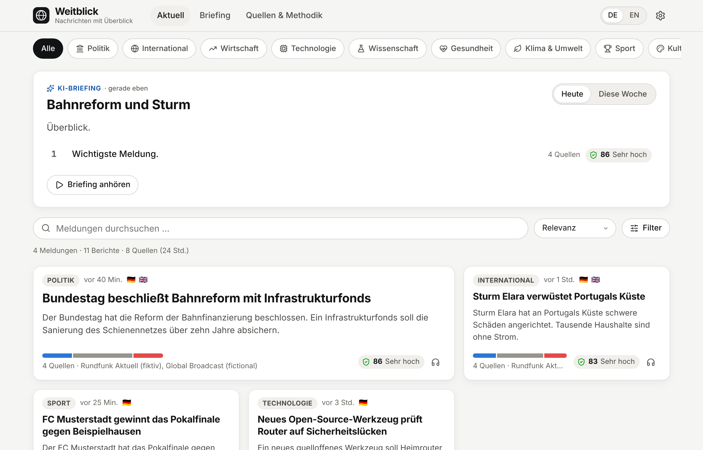

# Weitblick – Nachrichten mit Überblick

Weitblick ist eine **kostenlose** Nachrichten-App nach dem Vorbild von Ground News. Sie sammelt laufend
die neuesten Meldungen aus rund 50 Medien (Deutschland, Österreich, Schweiz und international), fasst
Berichte über dasselbe Ereignis zu **einer Meldung** zusammen und zeigt, **wer wie darüber berichtet**.

Die App läuft komplett auf GitHub – ohne Server, ohne Abo, ohne API-Schlüssel:
**https://marcolinder-hainzer.github.io/newsapp/**

| Startseite | Meldung | Mobil (dunkel) |
|---|---|---|
|  |  |  |

<sub>Screenshots mit fiktiven Testdaten.</sub>

## Funktionen

- **Immer aktuell** – alle 15 Minuten werden rund 130 RSS-Feeds von 60 Medien abgerufen.
- **Nur Österreich** – ein Schalter zeigt nur die aktuellsten Themen aus Österreich (erkannt über
  österreichische Medien, die ORF-Bundesländer-Feeds und typische Begriffe wie Nationalrat, ÖVP, Wien …),
  inklusive eigenem Briefing „Das Wichtigste aus Österreich“. In den Einstellungen als Standard wählbar.
- **Kategorien & Filter** – Kategorie-Auswahl als Ausklappmenü: Politik, International, Wirtschaft, Technologie, Wissenschaft, Gesundheit,
  Klima & Umwelt, Sport, Kultur, Panorama. Filter nach Zeitraum, Sprache und Land der Quellen,
  politischer Perspektive (ausgewogen, überwiegend links/rechts, „Blindspots“), Mindest-Vertrauen und
  Mindestanzahl an Quellen; Volltextsuche und Sortierung.
- **Zusammenfassung jeder Meldung auf Deutsch und Englisch** – die aussagekräftigsten Sätze aller
  berichtenden Medien plus „So berichten weitere Medien“. Fehlt eine Sprache, wird kostenlos mit den
  Open-Source-Modellen **OPUS-MT** übersetzt.
- **Briefings** – das Wichtigste je Kategorie sowie die Top-Meldungen **des Tages** und **der Woche**.
- **Vorlesen mit natürlichen Stimmen** – jede Meldung und jedes Briefing, wahlweise mit **Damen- oder
  Herrenstimme** (Deutsch: Kerstin/Thorsten, Englisch: Lessac/Ryan). Die neuronalen Open-Source-Stimmen
  (Piper) werden direkt auf dem Gerät erzeugt; einstellbares Tempo, „Alle anhören“, Sperrbildschirm-Steuerung.
- **Vertrauens-Score (0–100)** für jede Meldung – mit nachvollziehbarer Aufschlüsselung.
- **Ausrichtung der Berichterstattung** – Balken links/Mitte/rechts und Liste aller Originalartikel.
- **Anpassbar** (Zahnrad oben rechts → Einstellungen): Startseite, Standard-Region und -Filter,
  Akzentfarbe, Ecken, Kartenstil, Schriftgröße, Abstände, Kachel- oder Listenansicht, welche Elemente
  die Karten zeigen, Reihenfolge und Sichtbarkeit der Startseiten-Bereiche und Kategorien, einzelne
  Medien ausblenden, Stimme und Tempo. Alles wird nur im Browser des Geräts gespeichert.
- **Installierbar als App** (PWA) auf iPhone, Android und Desktop; heller und dunkler Modus;
  Schnellzugriffe „Nur Österreich“, „Briefing“ und „Einstellungen“ (langes Drücken auf das App-Symbol).

## Warum ist alles kostenlos?

| Baustein | Lösung | Kosten |
|---|---|---|
| Hosting | GitHub Pages | 0 € (öffentliches Repository) |
| Regelmäßige Aktualisierung | GitHub Actions, alle 15 Minuten | 0 € (öffentliches Repository) |
| Nachrichten | öffentliche RSS-Feeds der Medien | 0 € |
| Zusammenfassungen | automatische Satzauswahl (TF-IDF) | 0 € |
| Übersetzung DE ↔ EN | OPUS-MT (Universität Helsinki, Open Source), läuft in der GitHub Action | 0 € |
| Briefings | automatisch aus den relevantesten Meldungen | 0 € |
| Vertrauens-Score | Quellenbewertung + Heuristik | 0 € |
| Vorlesen | Piper-Stimmen (Open Source), laufen im Browser des Geräts; alternativ Gerätestimmen | 0 € |

Im Vergleich zu einer Variante mit kostenpflichtiger KI entfallen: frei formulierte KI-Zusammenfassungen,
der Abschnitt „Warum das wichtig ist“, KI-geschriebene Briefings, die KI-Inhaltsprüfung im
Vertrauens-Score und Premium-Stimmen.

## Einrichtung (einmalig)

1. Im Repository auf github.com: **Settings → Pages → Build and deployment → Source: „GitHub Actions“**.
2. **Actions → „Nachrichten aktualisieren“ → Run workflow** – nach einigen Minuten ist die Seite online.
   Danach aktualisiert sie sich automatisch.
3. Auf dem Handy die Adresse öffnen und **„Zum Home-Bildschirm“** wählen (iOS: Teilen-Menü, Android: ⋮).

Hinweise:
- Beim ersten Lauf werden viele Meldungen auf einmal übersetzt. Pro Lauf wird höchstens 7 Minuten
  übersetzt (die wichtigsten Meldungen zuerst), der Rest folgt in den nächsten Läufen. Bis dahin wird die
  Originalsprache angezeigt.
- **Stimmen:** Beim ersten Anhören wird die gewählte natürliche Stimme einmalig geladen (ca. 60 MB je
  Stimme, plus ca. 30 MB Laufzeit) und danach auf dem Gerät gespeichert – am besten im WLAN. Die Modelle
  stammen aus dem offiziellen Piper-Stimmenarchiv (huggingface.co/rhasspy/piper-voices). Unter
  *Einstellungen → Art der Stimme* lässt sich alternativ die eingebaute Stimme des Geräts wählen.
- GitHub pausiert zeitgesteuerte Workflows in öffentlichen Repositories nach 60 Tagen ohne neue Commits
  und schickt vorher eine E-Mail; reaktivieren geht mit einem Klick unter *Actions*.

## So funktioniert es

```
RSS-Feeds ──► Abruf ──► Gruppierung zu Meldungen ──► Kennzahlen & Vertrauens-Score
                                                         │
   Briefings ◄── Übersetzung DE↔EN (OPUS-MT) ◄── Zusammenfassung (Satzauswahl)
                                                         │
                             statische JSON-Dateien ──► GitHub Pages
```

1. **Abruf** (`backend/app/ingest.py`): alle Feeds parallel, mit ETag/Last-Modified, Kategorie aus
   Feed, URL-Pfad oder Schlüsselwörtern. Gespeichert werden nur Titel, Teaser, Bild und Link.
2. **Gruppierung** (`cluster.py`): Artikel werden per TF-IDF-Ähnlichkeit von Titel und Teaser derselben
   Meldung zugeordnet. Über die Übersetzungen finden auch deutsch- und englischsprachige Berichte zum
   selben Ereignis zusammen.
3. **Kennzahlen** (`stories.py`): Anzahl Quellen, Länder, Verteilung links/Mitte/rechts, Blindspots,
   Relevanz (Abdeckung × Aktualität × Vertrauen).
4. **Zusammenfassungen** (`summarize.py`): Überschrift des zuverlässigsten Mediums, die zentralen Sätze
   aus den Teasern aller Quellen und die Schlagzeilen weiterer Medien.
5. **Übersetzung** (`translate.py`): OPUS-MT de→en / en→de, mit Zwischenspeicher und Zeitbudget.
6. **Briefings** (`digests.py`) und **Export** (`static_export.py`) als JSON für das Frontend.
7. **Vorlesen** (`frontend/public/piper-worker.js`, `frontend/src/audio/natural.ts`): Piper im Browser –
   espeak-ng (WebAssembly) erzeugt die Lautschrift, onnxruntime-web das Stimmmodell. Der Workflow
   „Stimmen prüfen“ testet alle Stimmen in Chromium und WebKit (Safari).

### Vertrauens-Score

| Faktor | Gewicht | Grundlage |
|---|---|---|
| Zuverlässigkeit der Quellen | 45 % | Faktentreue der berichtenden Medien |
| Unabhängige Bestätigung | 25 % | Anzahl unabhängiger Medien |
| Vielfalt der Perspektiven | 10 % | Politische Lager und Länder |
| Inhaltliche Qualität | 20 % | Reißerische Überschriften, reine Meinungsbeiträge |

Einstufung: ab 80 „sehr hoch“, ab 65 „hoch“, ab 50 „mittel“, darunter „niedrig“.

### Quellen anpassen

Die Quellenliste liegt in [`backend/app/data/sources.json`](backend/app/data/sources.json). Für jedes Medium
sind Land, Sprache, politische Ausrichtung (`left`, `lean_left`, `center`, `lean_right`, `right`),
Zuverlässigkeit (0–100) und die Feeds hinterlegt. Die Einordnungen sind **Näherungswerte**, angelehnt an
öffentliche Medienbewertungen (u. a. AllSides, Media Bias/Fact Check, Ad Fontes Media), und können frei
angepasst werden. Welche Feeds nicht funktionieren, steht im Protokoll der GitHub Action
(„Feed fehlgeschlagen“).

## Auf dem eigenen Rechner ausführen (optional)

Voraussetzungen: Python ≥ 3.11 und Node.js ≥ 20.

```bash
python -m venv .venv && source .venv/bin/activate
pip install -r backend/requirements.txt
# optional, für die Übersetzung:
pip install torch --index-url https://download.pytorch.org/whl/cpu
pip install -r backend/requirements-translate.txt

cd frontend && npm ci && npm run build && cd ..
cd backend && uvicorn app.server:app --port 8000
```

Danach ist die App unter <http://localhost:8000> erreichbar. Alternativ mit Docker:
`docker compose up -d --build` (ohne Übersetzung). Einstellungen siehe [`.env.example`](.env.example).

## Entwicklung

```bash
cd backend && pip install -r requirements-dev.txt && python -m pytest   # Tests mit fiktiven Feeds
cd frontend && npm run dev                                               # Frontend mit Hot-Reload
```

```
backend/app/     Abruf, Gruppierung, Score, Zusammenfassung, Übersetzung, Export (SQLite)
frontend/src/    React + TypeScript (Vite), PWA
.github/         GitHub Action für Aktualisierung und Veröffentlichung
```

## Hinweise

- Weitblick zeigt nur Überschriften, kurze Teaser aus den RSS-Feeds und daraus erstellte Zusammenfassungen
  – die Originalartikel sind stets verlinkt.
- Zusammenfassungen und Übersetzungen entstehen automatisch und können Fehler enthalten; im Zweifel gilt
  der verlinkte Originalartikel.
